# Missions

Any time you travel to attend a conference, for a research meeting, or for your period abroad, it is called a
mission. Each mission must be approved by the PhD director. You must use the [dedicated
form](https://forms.gle/YEsRWyUU6QSPKBbGA) to obtain such approval at least 2 weeks in advance. This is always the
first step you have to take. If the mission is for your [period abroad](period-abroad.md), the period abroad must also be approved with its own form.

Missions are usually paid with your [research budget](research-budget.md). Up to one yearly amount of the research budget (about €1,620) can also be used for accommodation during your period abroad, provided the stay lasts more than 6 months in total.

## Before the mission

After you have received the approval from the PhD director (or the deputy director), you have to fill in the mission request in [the U-GOV/UWeb system](https://unimib.u-web.cineca.it/appautmis#!/listaautmis) to obtain the official authorization to travel. The request is authorized by the PhD director and by the Head of the Department, so submit it before you leave, around 15 days in advance. The authorization also gives you insurance coverage while you are travelling.

Log in with your @campus.unimib.it credentials. When you are logged in, you will be able to access the on-line help. Then:

1. Click on “New claim” (“Nuova richiesta”) and fill in the location and the expected start and end dates of your mission.
2. Type of request (“Tipo richiesta”): select “MPR - Missioni su progetti”, which means that your mission will be paid with a research fund.

   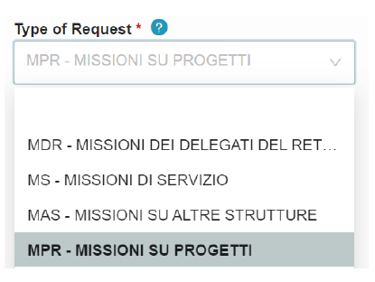

3. Head of project (“Responsabile progetto”): select “Gianluca Della Vedova”.
4. Project (“Progetto”, or “Fondo di ricerca”): leave this field empty. It will be filled in by the PhD director.

   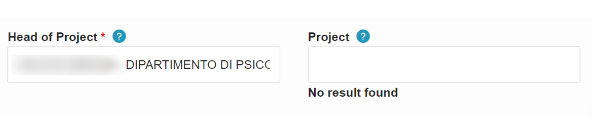

5. Regulation (“Regolamento”): select “TES - Regolamento di Ateneo” (“University rules”). That means that the University mission rules apply.

   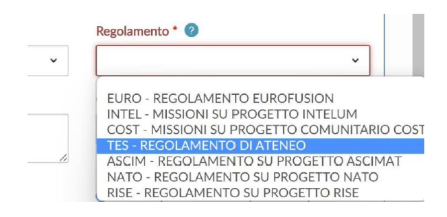

6. Reason (“Motivazione”): write a clear explanation of the goal of the mission (e.g. “presenting the paper XYZ at the ABC 2026 conference”, or “participation in the XYZ 2026 summer school on Excellent Research”).

   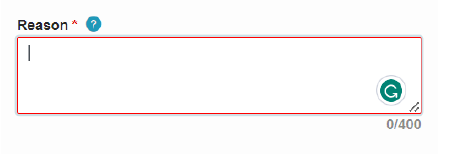

7. Description (“Causale”): select the appropriate type of mission. “Ricerca di base” (basic research) is almost always the correct choice.
8. Extraordinary means of travel (“Mezzi straordinari”). The mission rules describe what those are. In short, you will have to fill in this part only if you want to use your own car (which is discouraged anyway).
9. Estimated expenses (“Spese a preventivo”): add the expected expenses, either as a single total or itemized, if you already know the cost of some items (e.g., conference fee, plane ticket).

   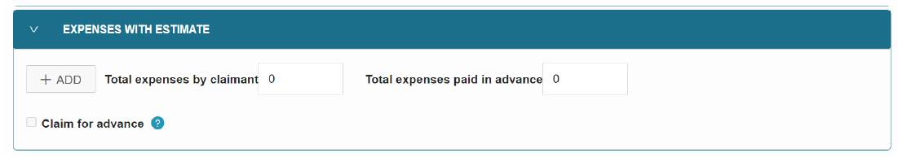

   Prepare an **accurate budget** that takes into account all possible expenses. If the actual expenses differ greatly from the estimate (either up or down), inform the PhD director once you have been reimbursed, so that your research budget can be updated.

10. Attachments (“Allegati”): upload documents showing that the mission is actually a scientific mission (e.g., the acceptance of your paper, the receipt of the registration fee, an email confirming your registration).

    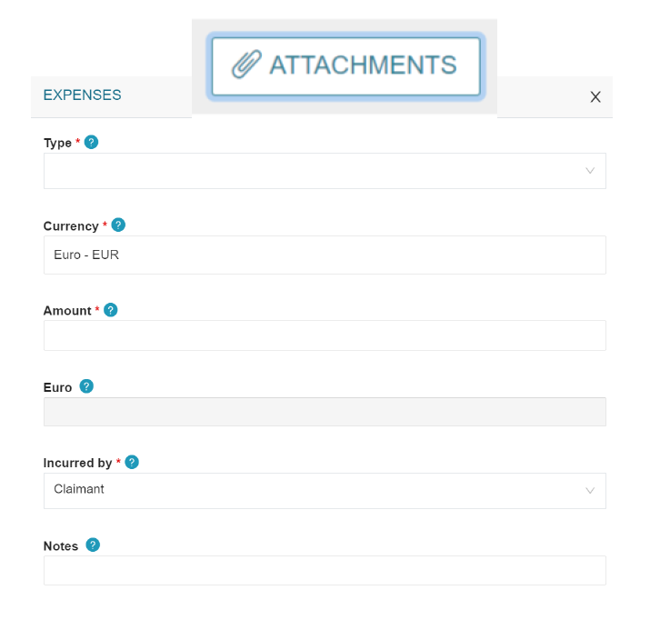

## Advance payments (DepotLab)

If you plan sufficiently in advance, the University can pay some of your expenses directly, so that you do not have to advance the money:

- registration fees for conferences, schools, courses and workshops;
- travel and accommodation.

Advance payments made with your research budget must be requested through the [DepotLab portal](https://depot.unimib.it/depot_centri). Administrative procedures can take a long time, so submit your request **at least one month** before the relevant deadline (for example, the registration deadline of the conference).

### Step 0: preliminary checks

1. Contact the PhD director to check that the request is suitable and that funds are available.
2. Contact the organizers of the conference or school, and tell them that the fee will be paid through a purchase order issued directly by the University.

### Step 1: fund authorization

Before you can use DepotLab, you must be authorized to access the fund.

- Ask the PhD director the ID number of the fund to be used.
- Send an email to the department's [research support office (Ufficio Supporto Ricerca)](https://www.unimib.it/ugov/organizationunit/420592), with the PhD director in CC, asking to be enabled for the assigned PhD fund to make purchases on DepotLab.

### Step 2: access the portal

Once your authorization is confirmed, log in to [DepotLab](https://depot.unimib.it/depot_centri) with your University credentials.

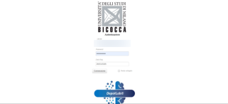

### Step 3: check the supplier

In the “Nuova Rich. Libera” (new free request) section, search for the supplier (that is, the conference or school organizer) by VAT number or name in the “Fornitore” field.

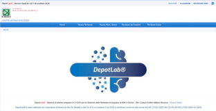

- If the supplier is registered, move to step 4.
- If the supplier is not registered, email the department's [research support office](https://www.unimib.it/ugov/organizationunit/420592) and [accounting office (Ufficio Contabilità e Amministrazione)](https://www.unimib.it/ugov/organizationunit/420591), asking them to add the supplier. Include the supplier's business name, VAT/tax ID, and address.

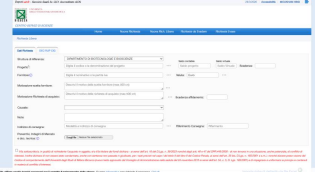

### Step 4: submit the purchase request

Once the supplier is available and the fund is active, go to “Nuova Rich. Libera” and fill in the mandatory fields:

- Struttura di afferenza: Department of Informatics, Systems and Communication.
- Motivazione (reason): briefly explain why the purchase is necessary for your research.
- Indirizzo di consegna (delivery address): Online.

Tick the box at the bottom (the red text about conflict of interest and responsibility), and submit the request.

### Step 5: receive the billing instructions

The DepotLab team will send you the billing information (including the order number) that you must forward to the supplier, so that they can issue a correct invoice.

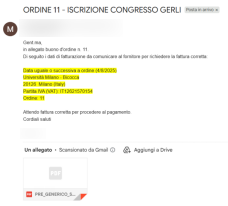

### Step 6: finalize the payment

Send the billing details to the supplier. When the supplier sends you the invoice, forward it to the University, which will then pay it.

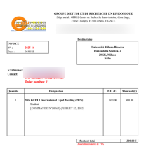

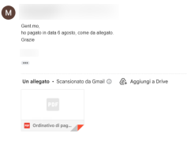

### Travel and accommodation

To have the University pay for your travel and accommodation, first complete step 0 and step 1 above, and submit the mission request in [UWeb](https://unimib.u-web.cineca.it/appautmis/listaautmis/create) (see [Before the mission](#before-the-mission)). The mission request is needed anyway to be reimbursed for the other expenses, such as meals.

#### Step 7: authorization form

Ask the department's [accounting office](https://www.unimib.it/ugov/organizationunit/420591) for the **prior authorization form** and fill in all its sections:

- _Flights_: departure date and time, departure and arrival airports, price, whether you need checked luggage, link
  to the airline website and screenshots of the selected flights, both outbound and return. Provide the same
  information for train or ferry tickets, if applicable.
- _Hotel_: check-in and check-out dates, link to the website where you found the accommodation, and a screenshot of
  the selected option.
- Your personal details, the location and name of the conference, the link to the event, and the mission number.

#### Step 8: submit the purchase request

Submit the request in DepotLab as in step 4, with these differences:

- select REGENT INTERNATIONAL S.R.L. (the University's travel agency) as the supplier;
- upload the prior authorization form in the Attachments section (at the top).

#### Step 9: interaction with the travel agency

The travel agency will contact you for the next steps, and to send you the tickets and the accommodation booking.

## After the mission

After the completion of the mission, use the same UWeb system to request the reimbursement of your expenses. The
sooner you submit your request, the sooner you will be reimbursed.

- You need **acceptable evidence** for each expense (e.g., clear and fiscally valid receipts). The PhD director and
  the Head of the Department authorize the mission, but they do not decide which expenses are reimbursed: the
  University mission office does. The list of eligible expenses can be found in the _Mission rules_ ([_Regolamento
  Missioni_](https://www.unimib.it/sites/default/files/allegati/regolamentomissionien.pdf)).
- Upload the **certificate of attendance** into UWeb. Otherwise the office has to verify your participation
  manually, which can significantly delay your reimbursement.
- For archival purposes, send the department's [research support
  office](https://www.unimib.it/ugov/organizationunit/420592) the summary sheet of expenses and all supporting
  documents uploaded to the portal: tickets, receipts, authorization, expense reports, invitation emails, certificate
  of attendance, registration fees, etc.

We strongly recommend keeping a single file that tracks, for each mission, the amount requested, the amount still to
be reimbursed, and the amount actually credited to your bank account, together with the remaining balance of your
research budget. Share it periodically with the PhD director: it makes it easy to check the status of each
reimbursement and to keep your budget up to date.

## Paper missions

Some missions are handled with a paper form, the [mission form](files/mission-form.pdf) (“Incarico di missione”), instead of UWeb.
The most common cases are a mission within a mission (you attend a conference during your period abroad) or you want
to use your research budget in the last few months of your PhD, just before graduating.

Before the mission:

1. At least **one week** before the mission, fill in section A (“Quadro A”) of the form with your details, the
   destination, a detailed reason for the mission, the dates and the means of transport. Leave the mission number
   and the signature blank: the mission number is assigned by the department office, and the signature belongs to
   the head of project (the PhD director). Always attach a document describing the event, such as the conference
   flyer or program.
2. The head of project tells the department office the code of the project that will pay for the mission.
3. When the office receives the form, it assigns the mission number and has the form signed by the Head of the
   Department.

After the mission:

1. Fill in the remaining sections of the form: the departure and arrival dates and times (section C), and the list
   of travel expenses (“Spese di viaggio”).
2. Hand in the form together with the **originals** of all receipts and supporting documents for your expenses, and
   the certificate of attendance.

The [mission rules](https://www.unimib.it/sites/default/files/allegati/regolamentomissionien.pdf) also apply to
paper missions. The last two pages of the rules summarize the reimbursable expenses, their maximum amounts, and who
is entitled to a reimbursement.

For problems and doubts, contact the PhD director. Senior PhD students and the PhD student representatives have
already been through this process, and can give you useful tips, especially on which expenses might not be
reimbursed. In particular cases, you can also write to <assistenzamissioniweb@unimib.it>.

The contacts of the department offices can be found in the [University organization chart](https://www.unimib.it/ateneo/organizzazione/organigramma).
